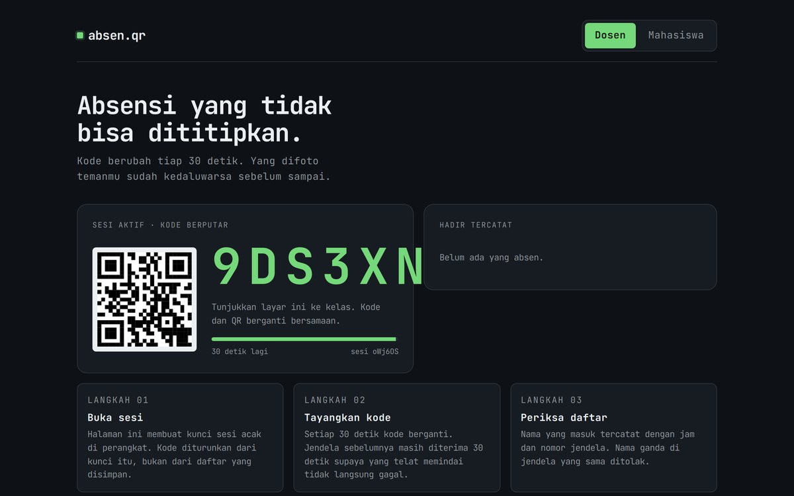

<div align="center">

# Absen QR

**Presensi kelas dengan kode yang diperbarui setiap 30 detik — kode yang difoto telah kedaluwarsa.**

[](https://atmajadesna.github.io/absen-qr/)


<a href="https://atmajadesna.github.io/absen-qr/"></a>

</div>

## Latar Belakang

Presensi dengan kode statis mudah dititipkan: kode difoto, dikirimkan kepada pihak lain, dan masih dapat digunakan pada pertemuan berikutnya. Presensi berbasis gambar QR konvensional menghadapi persoalan serupa karena gambar dapat disimpan.

## Poin Teknis

**Kode diturunkan dari waktu.** `kode = base32(HMAC-SHA256(kunci, "w:" + floor(now/30000)))`. Tanpa kunci, kode tidak dapat dihitung, sehingga tidak dapat ditebak hanya dari waktu.

**Toleransi satu jendela.** Jendela waktu sebelumnya masih diterima agar mahasiswa yang terlambat beberapa detik tidak gagal melakukan presensi.

**Nama ganda ditolak.** Satu nama hanya dapat tercatat sekali dalam satu sesi presensi.

**Kunci disimpan di perangkat.** Kunci 128-bit dan catatan presensi disimpan pada `localStorage`, sehingga tidak ada server yang perlu dipercaya.

## Menjalankan

Berkas `index.html` dapat dibuka langsung pada peramban tanpa proses build:

```bash
python3 -m http.server 8000
```

Tidak diperlukan dependensi maupun proses build. Seluruh proses berjalan pada peramban.

## Struktur Berkas

```
index.html    struktur halaman dan tampilan
app.js        seluruh logika: data, perhitungan, dan penyimpanan
styles.css    tata letak dan komponen antarmuka
tokens.css    warna, ukuran teks, dan spasi sebagai variabel
```

## Catatan

Demonstrasi ini berjalan sepenuhnya di sisi klien: kode dihitung pada peramban pengajar. Untuk penggunaan sebenarnya, verifikasi perlu dipindahkan ke server agar kunci tidak ikut terkirim.

Dibangun menggunakan JavaScript, Web Crypto, dan HTML, tanpa kerangka kerja.
